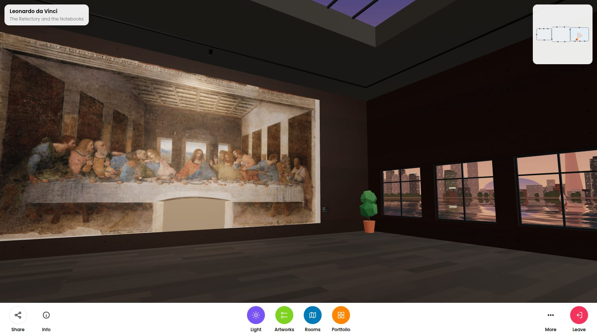
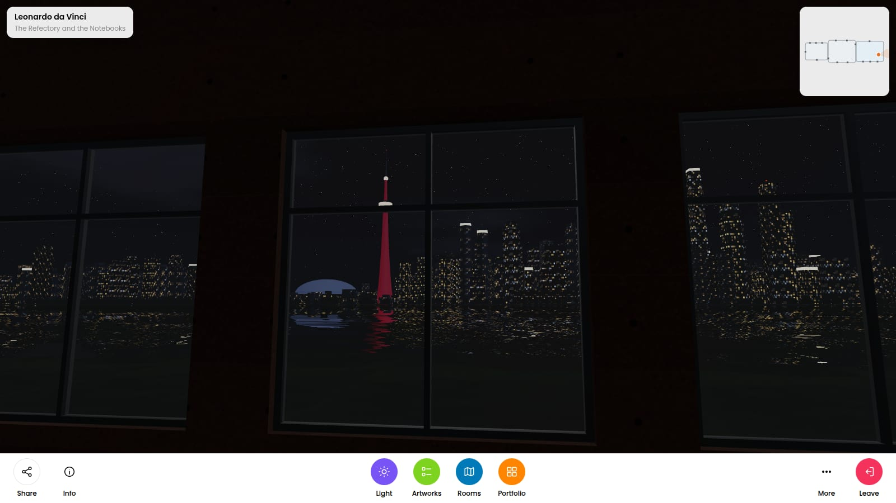
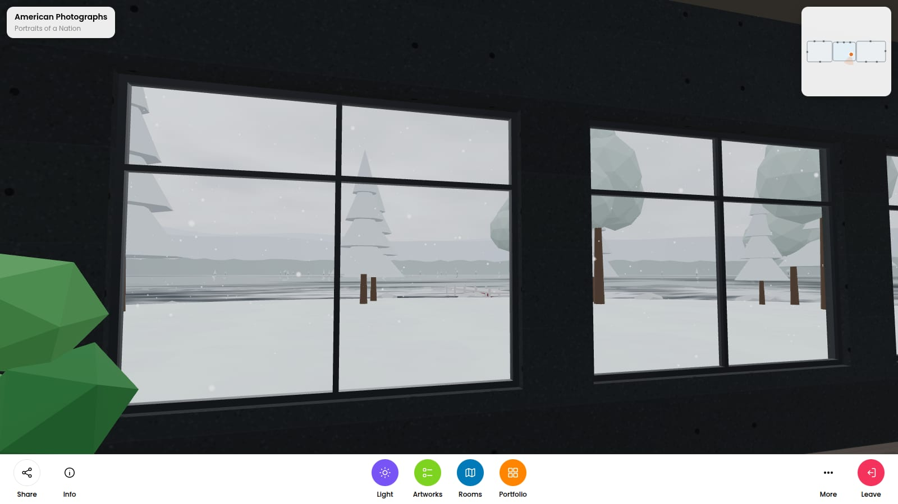
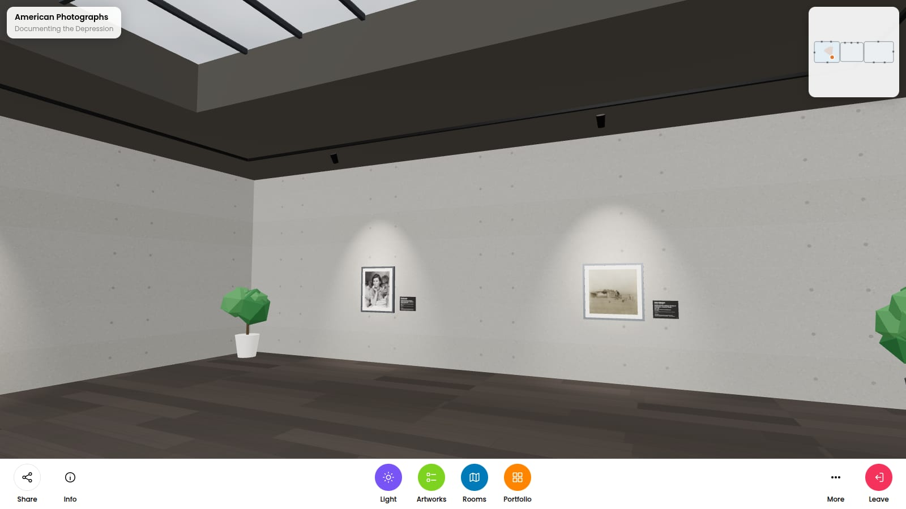
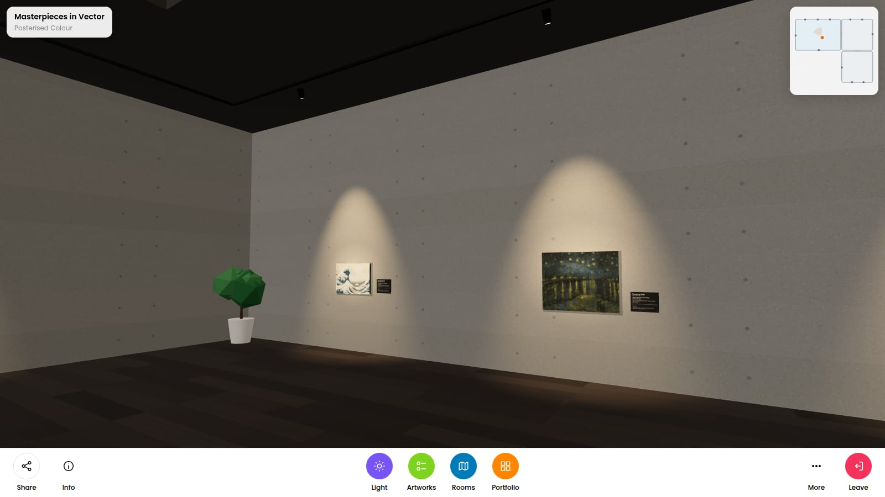
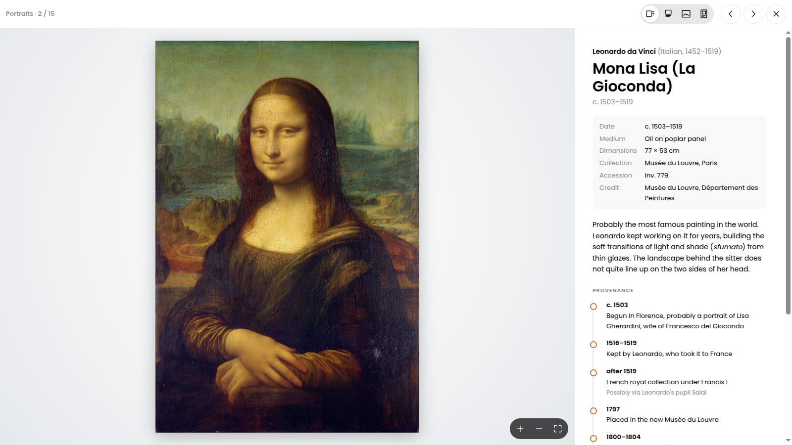
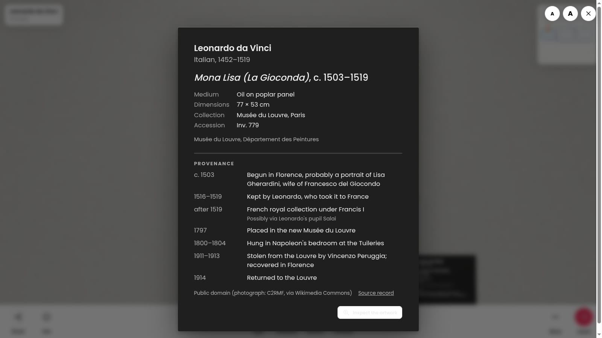
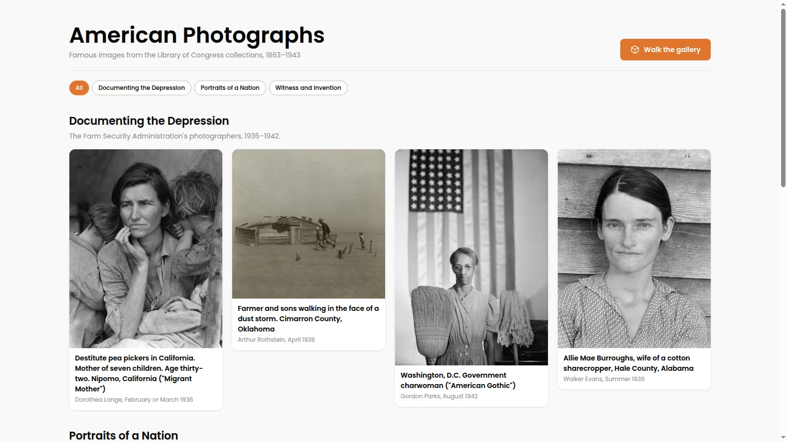
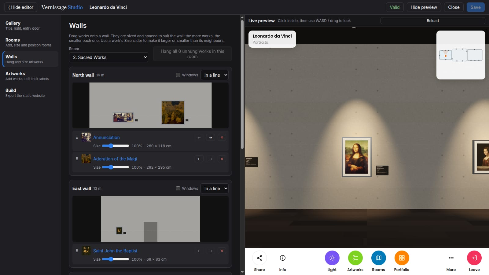

# Vernissage

Design a multi-room 3D art gallery on your desktop and publish it as a **static website**. Visitors walk through the rooms in first person, read museum-style wall labels, and can switch at any moment to a 2D **focus mode** that shows the artwork full-screen with its provenance, or to a searchable **portfolio** grid.

- **Vernissage Studio** (Electron) is where you set up rooms, walls, artworks, provenance, lighting and surroundings, with a live 3D preview.
- The **generator** (also available as a CLI) turns a project folder into a self-contained site: one `index.html`, one script and optimised images. It needs no server-side code, so you can upload the output to any static host.
- The project ships with three demos: **Leonardo da Vinci**, **American Photographs** (Library of Congress) and **Masterpieces in Vector** (SVG traces).



*The Leonardo da Vinci demo at dusk: the* Last Supper *at full size, and Toronto across the harbour.*

## Quick start

```bash
npm install
npm run studio                     # build everything and open Vernissage Studio
npm run demos                      # build the three demo sites into out/
node packages/generator/dist/cli.js serve out/davinci   # http://127.0.0.1:8080/
```

Requires Node 20+ (developed on Node 26). The studio's first launch downloads the Electron binary.

## Look and feel

The interface is modelled on **Mozilla Hubs**, the open-source social-VR space (2018–2024, now maintained by the Hubs Foundation). Vernissage takes Hubs' interaction patterns and design language but none of its code, icons or branding:

- **Lobby flow:** a loading screen, then a room-entry card (*Join gallery* / *Browse portfolio*) while the camera slowly circles the first room.
- **Bottom toolbar** of round, labelled, colour-coded buttons: Share and Info on the left; Light, Artworks and Rooms in the middle; More and a red Leave on the right. White panels, the Poppins typeface, 8–12 px radii.
- **Sidebars** on the right: *Artworks* (like Hubs' Objects list) and *Rooms* (where Hubs had People). They go full screen on phones. Notifications appear at the bottom left.
- **Object menu:** hover a work to see an outline; click it, or press Space/Tab, to get a dark pill with *Inspect*, *Walk here*, *Source* and *Share*, and ‹ 3 / 15 › paging through the tour.
- **Movement:** WASD/arrows, **Q/E snap-turn**, drag to look, **right-click (long-press on touch) teleport** with an arc and landing ring, and click-to-walk.
- **One look:** every gallery uses the **Industrial Loft** style (raw concrete walls, dark plank floor, steel frames, orange accent) with **Daylight** as the starting lighting. The other style presets still exist in the code but are not offered in the studio.

Hubs was multi-user. A Vernissage gallery is visited alone and in first person, so avatars, name tags, emoji reactions, voice and chat are left out.

## The visitor experience

| | |
|---|---|
|  |  |
| The sky follows Toronto's time and weather: night… | …or snow, live from Environment Canada or chosen in the Light menu. |
|  |  |
| Daylight through the roof lanterns by day… | …and spotlights once it is dark. |
|  |  |
| Focus mode: the work, its label and its history. | The wall label up close, with the full provenance. |
|  | |
| The portfolio: every work on one page, filtered by room. | |


| | |
|---|---|
| **3D gallery** | You explore in first person. Move with WASD or ↑/↓, turn with ←/→ or snap-turn with Q/E, look by dragging, zoom with the mouse wheel (it narrows the view like binoculars, up to about 4×; press the wheel or Esc to reset), teleport with right-click. Click the floor to walk there and click a work to select it. There is a touch joystick on phones (long-press to teleport) and a minimap you can click to jump straight to a spot. |
| **Labels** | Each work has a "tombstone" card beside or below it: artist, life dates, title, date, medium, dimensions, credit line and a one-line provenance. Click it, press **L** or choose *Label* in the object menu for a close-up with the full provenance and adjustable text size. |
| **Sky and surroundings** | A glazed roof lantern in every room 5 m wide or more and picture windows on bare outside walls look out on a lake. The sky is drawn live: drifting clouds, the sun in its real place, stars and the moon in its real phase at night. The scenery is a grassy island on a **lake shore** (dock, woods, hills) or the **Toronto skyline** across the harbour: the CN Tower, the Rogers Centre, the bank towers and the condo wall along the waterfront, all reflected in the water, with windows lighting up at dusk, a ferry and sailboats. The skyline faces the side of the building with the most window area. |
| **Time and weather** | By default the sky shows **Toronto right now**: the time of day is worked out in the browser from the sun's position, and the weather (clear, cloudy, rain, thunderstorm, snow or fog) comes from Environment and Climate Change Canada. Rain and snow fall outside, snow settles on the island, fog hides the city, storms flash. In the *Daylight* lighting the rooms follow the sky: they dim under cloud and the spotlights take over at night. Visitors can fix the time of day and the weather in the **Light** menu. |
| **Focus mode** | *Inspect* from the object menu, or **Enter** near a work. Four layouts: *side by side*, *stacked*, *immersive* (full-bleed, info drawer on **I**) and *catalogue* (printed-plate look). Includes pan and zoom, ← → through the whole tour, a provenance timeline and source and rights links. SVG works stay vector-sharp at any zoom. |
| **Portfolio** | A 2D grid grouped by room, with a room filter; reached with the **Portfolio** button in the toolbar, or the first view if the gallery is set to start there. It is also the fallback when WebGL is unavailable, when the page is opened from `file://` (browsers block WebGL textures there), and for visitors with reduced-motion settings. |
| **Visitor choices** | Lighting scenario and graphics quality, remembered in `localStorage`. The gallery owner can turn the lighting choice off. |
| **Deep links** | `#/art/<id>`, `#/room/<id>`, `#/portfolio`. `?enter` skips the welcome screen. |

### Live weather and privacy

With `environment.weather` set to `live` (the default), each visitor's browser asks Environment and Climate Change Canada's public GeoMet API for Toronto's current conditions when the gallery opens and every 15 minutes after that. This is a request to a third party; it carries no cookies and no referrer. Set a fixed weather in the studio (*Gallery → Surroundings*) or in `gallery.json` to switch it off: the request is then never made and visitors are not offered "Live" weather. The time of day needs no request.

## Studio




Start a **new gallery** (one tall room: three walls for art, a windowed wall onto Toronto, an entry door), start **from a Google Photos album**, copy a demo, or open a project folder. A new project may use a folder that already has files in it: the studio names what is there and asks before deleting it, and refuses folders such as your home folder, Documents or Desktop.

The editor on the left folds away with the *Hide editor* button or **Ctrl+E**, so you can walk the gallery in the whole window and fold it back to carry on. Panes:

- **Gallery**: title, subtitle, intro (Markdown); whether visitors **start in** the gallery or the portfolio; the **menu bar** (links to other pages, and a contact address for a *Contact* link); the **indoor light** (Daylight, Gallery white, Evening spots, Chiaroscuro, Night tour); the **entry door** and the address it opens; the scenery outside. The sky needs no settings: it follows Toronto's time and weather, and visitors can change it in the Light menu.
- **Rooms**: add rooms, set their size and height, and drag them into position. A room can have a **pinboard** next to its door, with instant photos (mini, square, wide; a short line on the white border) and Markdown notes; visitors can move the cards around on the board, and each visitor's arrangement stays in their own browser. Each room's **plants** are placed automatically, clear of pictures and doors; on the plan of the selected room you can add, move, resize and remove them by hand. Doorways are generated between consecutive rooms that face each other.
- **Walls**: an elevation drawing of each wall. Tick *Windows* to make a wall a window wall, or drag works onto it. Works are sized and spaced automatically to suit the wall; each has a **Size** slider that changes that work only and stops where the wall is full. Tick works under *Not hung yet* to hang just those in the room. ← and → move a work along the wall, and past a door to the wall's other side. Hanging can be in a line, stacked or in a grid.
- **Artworks**: add JPG/PNG/SVG files by button or drag and drop, or add photos from a Google Photos album (see below), pick a work from the thumbnail strip, choose the wall it hangs on, and edit its label: title, artist, date, medium, description, further details and the provenance entries. *Show in preview* jumps to the work in the live preview, and a click on a work in the preview opens its entry here (a click on the wall beside the works opens that wall in the Walls pane).
- **Build**: choose an output folder (remembered per project) and an optional base path, then build. You can then open the site in the browser or reveal the folder.

The studio shows its version next to its name. After an update it lists once what changed since you last opened it; click the version for the whole changelog (`CHANGELOG.md`).

Settings without a control in the studio (display scales, focus-mode layouts, time and weather defaults, roof lanterns, plants, teleport) keep their defaults and can be changed in `gallery.json`.

### From a Google Photos album

Paste the link of an album **shared by link** (`https://photos.app.goo.gl/…`) on the start screen, or run `node packages/generator/dist/cli.js import-album <link> <new-folder>`. The importer:

- downloads each photo (longest side 4096 px; videos are skipped);
- suggests rooms from the number and shapes of the photos and hangs them in album order. A panorama (wider than 2.2 : 1) gets a wall to itself, so no smaller pictures compete with it;
- fills in each label: the **file name** as title, the date taken, the camera and its settings (focal length, aperture, shutter, ISO), and the **caption** you gave the photo in the album as its description. The album's owner is entered as the artist.

**Adding to a gallery later:** *+ Add from Photos album…* in the Artworks pane lists the album as it is now, marks the photos already in the gallery (matched by file name) and adds only the ones you tick. Works and image files already in the project are never changed. The added works are not hung yet.

Google offers no interface for public albums, so the importer reads the album's web pages, as a browser would. If Google changes those pages the import can stop working. Only the first page of a very long album (a few hundred photos) is read.

Packaging: `npm run dist -w @vernissage/studio` builds an AppImage and a .deb in `release/`.

## Project folder

```
my-gallery/
  gallery.json      the whole configuration (schema below)
  assets/           your images
  .cache/           generator cache (safe to delete, git-ignored)
```

### `gallery.json` (abridged)

```jsonc
{
  "schemaVersion": 5,
  "title": "…", "subtitle": "…", "intro": "Markdown",
  "style":    { "preset": "industrial-loft" },
  "lighting": { "scenario": "daylight", "overrides": { "ambient": 0.6, "spot": 1 }, "allowVisitorChoice": true },
  "layout":   { "mode": "linear | grid | custom", "columns": 2, "gap": 0.3 },
  "focus":    { "defaultLayout": "side-by-side", "layouts": ["side-by-side", "stacked", "immersive", "catalogue"] },
  "display":  { "sizing": "auto | true", "artScale": 1.2, "frameScale": 1.6, "labelScale": 1.35 },
  "environment": { "time": "live | dawn | day | dusk | night", "weather": "live | clear | cloudy | rain | storm | snow | fog",
                   "skylights": true, "windows": true,
                   "landscape": "lake | toronto", "plants": true },
  "startIn":  "gallery | portfolio",
  "menu":     [{ "label": "Home", "url": "https://primbs.ca" }],
  "contact":  "name@example.org",                                                   // optional: a Contact link in the menu bar
  "navigation": { "teleport": true, "lobbyOrbit": true },
  "entrance":   { "enabled": true, "url": "https://primbs.ca", "wall": "south" },   // wall is optional
  "artworks": [{
    "id": "mona-lisa", "file": "assets/mona-lisa.jpg", "title": "…",
    "artist": { "name": "…", "life": "1452–1519", "nationality": "Italian" },
    "date": "c. 1503–1519", "medium": "Oil on poplar panel",
    "dimensions": { "width": 53, "height": 77 },          // centimetres
    "collection": "…", "accession": "…", "credit": "…", "source": "https://…", "rights": "…",
    "description": "Markdown", "tags": ["portrait"],
    "provenance": [{ "date": "1797", "event": "Musée du Louvre", "note": "…" }],
    "frame": "style | none | thin-black | thin-white | oak | gilt | steel | float", "mat": true, "label": "right | below"
  }],
  "rooms": [{
    "id": "portraits", "name": "Portraits", "description": "…", "width": 13, "depth": 10, "height": 4.6,
    "wallColor": "#…", "position": { "x": 0, "z": 0 },      // position only for layout.mode = custom
    "walls": { "north": { "artworks": [{ "artwork": "mona-lisa", "scale": 1, "offset": 4.2, "height": 1.5 }], "hang": "centred", "windows": false },
               "east": {}, "south": {}, "west": {} }
  }]
}
```

The full schema, with defaults, is in [`packages/schema/src/model.ts`](packages/schema/src/model.ts). The generator, the viewer and the studio all validate against it. Errors and warnings (missing provenance, works shrunk to fit a wall, …) name the exact field.

## CLI

```bash
node packages/generator/dist/cli.js validate <project>
node packages/generator/dist/cli.js build <project> --out <dir> [--base /gallery/] [--force]
node packages/generator/dist/cli.js serve <dir> [--port 8080]
node packages/generator/dist/cli.js import-album <google-photos-link> <new-project-dir>
```

The generator refuses to write into a non-empty folder that it did not create, unless you pass `--force`. Even then it only replaces its own files (`index.html`, `site.json`, `app/`, `art/`, `build-report.json`).

### Output

```
index.html          viewer page with the gallery data inlined
site.json           the same data, for tools
app/viewer.js       the viewer (three.js), one classic script
art/<id>/thumb.webp      720 px
art/<id>/texture.webp    ≤ 2048 px, used in 3D
art/<id>/full.(jpg|png|webp|svg)   focus mode; SVGs are sanitised (scripts and handlers removed)
build-report.json
```

## Demos and their sources

| Demo | Lighting / scenery | Rooms |
|---|---|---|
| `demos/davinci` | Daylight, Toronto skyline | Portraits · Sacred Works · The Refectory and the Notebooks (the *Last Supper* at full size) |
| `demos/loc-photographs` | Daylight, lake shore | Documenting the Depression · Portraits of a Nation · Witness and Invention |
| `demos/svg-masterpieces` | Daylight, lake shore, grid layout | Posterised Colour · Ink · Minimal |

Every image is public domain or CC0. `npm run fetch-demos` re-downloads them from Wikimedia Commons and **refuses any file whose Commons licence metadata is not public domain, CC0 or "no known restrictions"**. It records the URL, licence and checksum in each demo's `sources.lock.json`. Wikimedia throttles anonymous scripts, so the fetcher backs off; set `VERNISSAGE_UA` to identify yourself if you run it often.

- **Library of Congress**: loc.gov's catalogue pages sit behind a bot challenge, so the fetcher uses Commons copies of LoC scans (and can use `tile.loc.gov` image URLs). The rights statements and LoC call numbers on the labels come from the published LoC records and were not re-checked automatically.
- **SVG traces**: `npm run vectorise` (needs `cargo install vtracer`) traces the originals in `.originals/` (git-ignored) in three styles. The traces are interpretations, and their labels say so.
- **Provenance** in the demos is condensed from the holding institutions' published histories. It is meant to show the feature and is not a scholarly record.

## Development

```
packages/schema     config schema, presets (styles, lighting, frames), floor-plan and hanging maths
packages/viewer     the static site's runtime (three.js + DOM UI), built with Vite into one IIFE
packages/generator  Node library + CLI (sharp for images)
packages/studio     Electron main/preload (esbuild) + Svelte 5 renderer (Vite)
scripts/            demo fetcher, vectoriser, rebuild-sample.sh
examples/sample     a tiny project used by tests and for quick iteration
```

```bash
npm test                    # vitest: schema, layout, hanging, collision, generator, demo validity
npm run typecheck
npm run check -w @vernissage/studio   # svelte-check
scripts/rebuild-sample.sh [project] [out]   # rebuild viewer + generator and regenerate a site
VERNISSAGE_SITE=out/davinci npm run dev     # viewer dev server against a built site
```

Studio development hooks: `VERNISSAGE_OPEN=<project>` opens a project at launch (without adding it to the recent list). `VERNISSAGE_SCREENSHOT=<png>` (optionally with `VERNISSAGE_JS`, `VERNISSAGE_WAIT`, and `VERNISSAGE_SIZE=1600x900` to render offscreen at an exact size) saves a capture of the window and quits.

## Licence

MIT, see [LICENSE](LICENSE). The demo images are public domain; see each demo's `sources.lock.json`.
